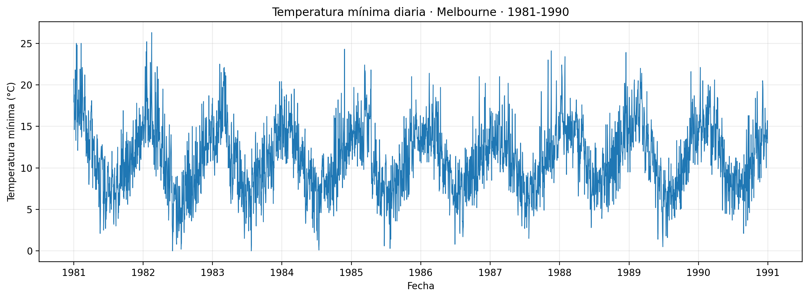
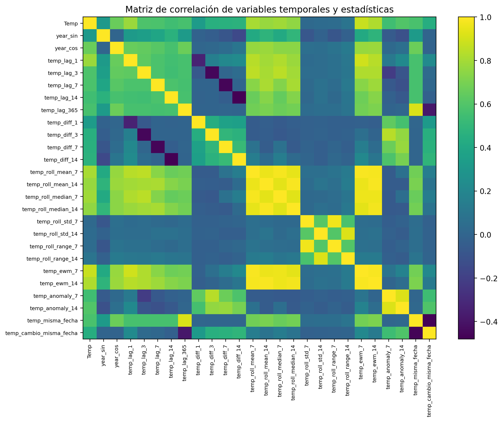
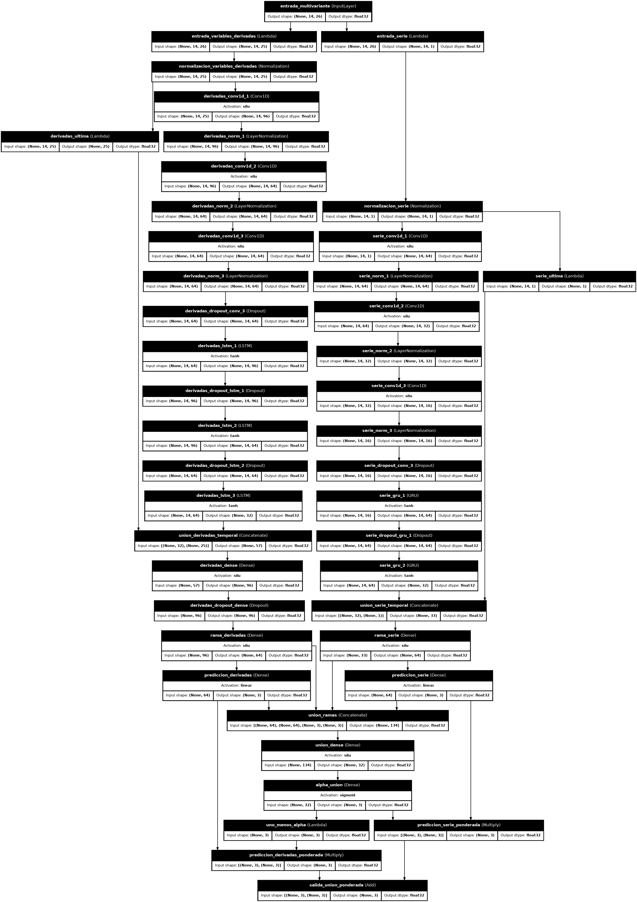
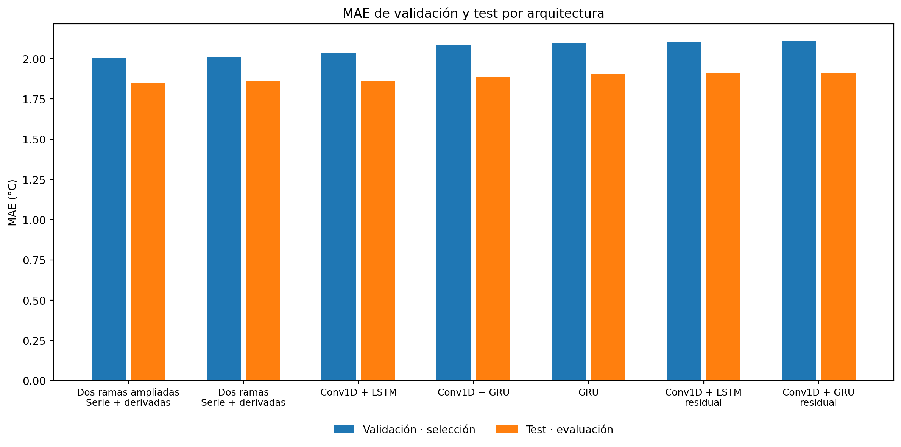
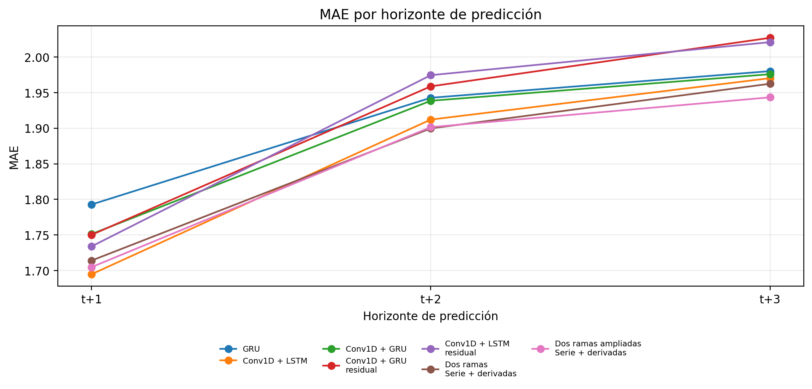
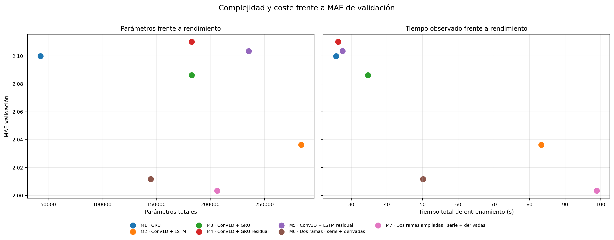
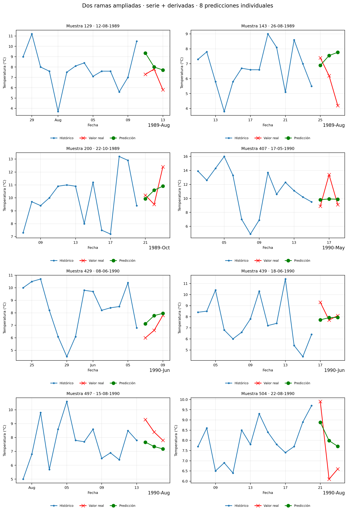

# Predicción de temperaturas con RNN

Proyecto de forecasting de series temporales con **Deep Learning** para predecir temperaturas mínimas diarias en Melbourne. El trabajo parte de una referencia GRU univariante y evoluciona hacia un escenario multivariante y **multi-step**, comparando arquitecturas GRU, LSTM, Conv1D, conexiones residuales y modelos de dos ramas con unión ponderada aprendida.

El repositorio procede de un ejercicio de formación que ha sido revisado, reorganizado y documentado como proyecto de portfolio reproducible.

## Objetivo

El proyecto estudia dos formulaciones relacionadas:

- **Referencia univariante:** 5 días de historial para predecir la temperatura situada en `t+2`.
- **Escenario multivariante:** 14 días de historial, 26 variables de entrada y predicción simultánea de `t+1`, `t+2` y `t+3`.

La selección de arquitectura se realiza exclusivamente con el conjunto de **validación**. El conjunto de **test** se reserva para la evaluación final.

## Dataset

Se utiliza la serie **Daily Minimum Temperatures in Melbourne**, con 3.650 observaciones diarias entre 1981 y 1990.

El notebook descarga los datos automáticamente desde el repositorio público de datasets de Jason Brownlee:

`https://raw.githubusercontent.com/jbrownlee/Datasets/master/daily-min-temperatures.csv`

La fuente histórica del conjunto se atribuye al **Australian Bureau of Meteorology**. Como el repositorio espejo utilizado no especifica de forma clara una licencia de redistribución para este archivo concreto, el dataset no se incluye en este repositorio. Consulta [`data/README.md`](data/README.md) para más detalles.



## Partición temporal

La serie se divide sin mezclar observaciones y respetando estrictamente el orden temporal:

- **TRAIN:** 2.400 observaciones.
- **VALIDACIÓN:** 600 observaciones.
- **TEST:** 650 observaciones.

La normalización se ajusta únicamente con datos de TRAIN.

## Ingeniería de variables

El escenario multivariante amplía la temperatura original con variables temporales y estadísticas derivadas, entre ellas:

- codificación estacional mediante seno y coseno;
- retardos temporales;
- diferencias y cambios respecto a observaciones anteriores;
- medias, medianas, desviaciones, mínimos, máximos y rangos móviles;
- medias exponenciales;
- medidas de anomalía;
- referencia a la misma fecha del año anterior.

El dataset final contiene **26 variables**. Estas variables se evalúan como conjunto; no se realiza un estudio de ablación individual.



## Arquitecturas evaluadas

Se comparan siete configuraciones multivariantes:

1. GRU.
2. Conv1D + LSTM.
3. Conv1D + GRU.
4. Conv1D + GRU residual.
5. Conv1D + LSTM residual.
6. Dos ramas · serie + derivadas.
7. Dos ramas ampliadas · serie + derivadas.

Las arquitecturas de dos ramas procesan por separado la serie principal de temperatura y las variables derivadas. Sus predicciones se combinan mediante un peso `α` aprendido por horizonte.



## Entrenamiento y selección

Todos los modelos utilizan el mismo esquema general:

- pérdida `MSE`;
- métricas `RMSE` y `MAE`;
- `ModelCheckpoint` sobre `val_loss`;
- `ReduceLROnPlateau`;
- `EarlyStopping` con restauración de los mejores pesos;
- selección final mediante `MAE` de validación.

Los tiempos de entrenamiento se incluyen solo como referencia relativa de la ejecución realizada y no como benchmark de hardware.

## Resultados globales

| Ranking | Modelo | Val MAE | Test MAE | Parámetros |
|---:|---|---:|---:|---:|
| 1 | Dos ramas ampliadas · serie + derivadas | 2.0034 | **1.8499** | 206.223 |
| 2 | Dos ramas · serie + derivadas | 2.0118 | 1.8587 | 144.895 |
| 3 | Conv1D + LSTM | 2.0364 | 1.8590 | 284.088 |
| 4 | Conv1D + GRU | 2.0863 | 1.8885 | 182.872 |
| 5 | GRU | 2.0998 | 1.9052 | 42.872 |
| 6 | Conv1D + LSTM residual | 2.1036 | 1.9097 | 235.608 |
| 7 | Conv1D + GRU residual | 2.1102 | 1.9119 | 182.872 |

La arquitectura **Dos ramas ampliadas · serie + derivadas** es la seleccionada mediante validación y también obtiene el menor `MAE` global sobre test.



## Resultados por horizonte

| Modelo | t+1 MAE | t+2 MAE | t+3 MAE |
|---|---:|---:|---:|
| GRU | 1.7928 | 1.9427 | 1.9801 |
| Conv1D + LSTM | **1.6948** | 1.9121 | 1.9702 |
| Conv1D + GRU | 1.7512 | 1.9385 | 1.9758 |
| Conv1D + GRU residual | 1.7502 | 1.9588 | 2.0269 |
| Conv1D + LSTM residual | 1.7339 | 1.9745 | 2.0208 |
| Dos ramas · serie + derivadas | 1.7140 | **1.8997** | 1.9624 |
| Dos ramas ampliadas · serie + derivadas | 1.7048 | 1.9015 | **1.9433** |

Conv1D + LSTM obtiene el menor error en `t+1`, la primera arquitectura de dos ramas en `t+2` y la arquitectura seleccionada en `t+3`. El Modelo 7 destaca por su equilibrio global y por mantener un error competitivo en los tres horizontes.



## Complejidad y coste

El mejor rendimiento no procede simplemente de aumentar el número de parámetros. La arquitectura seleccionada utiliza **206.223 parámetros**, menos que Conv1D + LSTM, que alcanza **284.088**.



## Análisis de la unión ponderada

En el Modelo 7, los valores medios aprendidos de `α` son aproximadamente:

- `t+1`: 0.3710
- `t+2`: 0.4076
- `t+3`: 0.0656

La rama de variables derivadas recibe mayor peso medio en los tres horizontes, especialmente en `t+3`. El diagnóstico también compara la unión adaptativa con una ponderación fija óptima, mostrando que los pesos aprendidos se sitúan en regiones coherentes con las combinaciones que reducen el error.

## Predicciones individuales

Las mismas fechas se utilizan para comparar visualmente la referencia univariante y el modelo final. El Modelo 7 representa simultáneamente los tres horizontes futuros sobre las fechas reales.



## Estructura del repositorio

```text
temperature-rnn-forecasting/
├── README.md
├── LICENSE
├── NOTICE.md
├── .gitignore
├── requirements.txt
├── environment.yml
├── notebooks/
│   └── temperature_rnn_forecasting.ipynb
├── data/
│   └── README.md
├── images/
│   └── 15 visualizaciones generadas por el notebook
└── outputs/
    └── 7 archivos CSV con métricas, diagnósticos y predicciones
```

Los checkpoints de entrenamiento no se versionan porque son regenerables ejecutando el notebook.

## Reproducibilidad

El notebook definitivo se ejecutó completamente con:

- Python 3.12.13
- TensorFlow 2.20.0
- Keras 3.14.0
- NumPy 2.4.4
- pandas 3.0.2
- Matplotlib 3.10.9
- JupyterLab 4.5.7

La ejecución final contiene 58 celdas de código ejecutadas de forma consecutiva y sin errores.

### Instalación con `pip`

```bash
python -m venv .venv
source .venv/bin/activate
pip install -r requirements.txt
jupyter lab
```

En Windows PowerShell:

```powershell
python -m venv .venv
.venv\Scripts\Activate.ps1
pip install -r requirements.txt
jupyter lab
```

### Instalación con Conda

```bash
conda env create -f environment.yml
conda activate DeepLearning
jupyter lab
```

Abrir después:

```text
notebooks/temperature_rnn_forecasting.ipynb
```

El notebook detecta si se ejecuta desde `notebooks/` y utiliza automáticamente la raíz del repositorio para guardar imágenes, outputs y checkpoints.

## Outputs disponibles

- `comparacion_modelos.csv`: ranking y métricas globales.
- `evolucion_t2.csv`: comparación del horizonte común `t+2` con la referencia univariante.
- `complejidad_modelos.csv`: arquitectura, parámetros, épocas y tiempo de entrenamiento.
- `metricas_por_horizonte.csv`: MSE, RMSE y MAE por horizonte.
- `generalizacion_modelos.csv`: relación TRAIN–VALIDACIÓN en el checkpoint seleccionado.
- `diagnostico_union_modelo_7.csv`: análisis de las ramas y del peso `α`.
- `predicciones_modelo_seleccionado.csv`: predicciones detalladas de las 634 muestras de test disponibles para el modelo final.

## Limitaciones

- El proyecto evalúa una única serie meteorológica histórica.
- La comparación entre la referencia univariante y el escenario multivariante refleja un cambio conjunto de variables, longitud de historial y formulación de salida.
- No se realiza ablación individual de las variables derivadas.
- Los tiempos de entrenamiento dependen del entorno de ejecución y solo sirven como referencia interna.

## Autor

**Carlos Ayllón Motto**

- GitHub: https://github.com/ayllonmotto
- LinkedIn: https://www.linkedin.com/in/carlos-ayllon-motto/

## Licencia

El código y la documentación de este repositorio se distribuyen bajo la licencia MIT. Consulta [`LICENSE`](LICENSE).

El dataset original no se redistribuye. Consulta [`NOTICE.md`](NOTICE.md) y [`data/README.md`](data/README.md) para la información de atribución y descarga.
